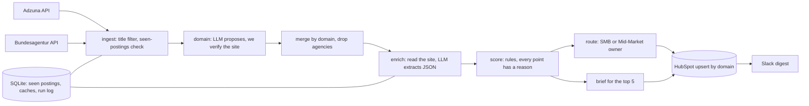

# secfix-signal-radar

Every morning it finds companies in Germany, Austria and Switzerland that are hiring for information-security roles, works out which ones are likely to need ISO 27001, TISAX or NIS2 help, puts them in HubSpot with a score and the reasons, and posts the top five to Slack for the reps.

I built it for Secfix's GTM Engineer role, as a small version of what the job describes: pull from several sources, dedupe, enrich, score, write back to the CRM, tell a rep who to call and why, and keep it running when something breaks.

## Latest run (2026-11-07)

Adzuna returned 1,462 postings for the ISO 27001 / TISAX / NIS2 / ISMS queries. 611 of them have a security-role title, from 276 distinct companies once obvious recruiters are dropped. The free LLM tier limits how many companies I can enrich per day, so the first run handled 5 and put them in HubSpot with a score, the reasons, evidence links and a brief; the daily cron works through the rest.

| # | Company | Score | Why |
|---|---|---|---|
| 1 | SAF-HOLLAND GmbH (safholland.com) | 100 | +30 hiring for a security role; +25 automotive supplier (TISAX need) |
| 2 | Schwarz Digits (schwarz-digits.com) | 75 | +30 hiring for a security role; +20 likely NIS2-regulated (Digital infrastructure) |
| 3 | adesso SE (adesso-group.de) | 75 | +30 hiring for a security role; +20 likely NIS2-regulated (Digital infrastructure) |
| 4 | Bundesdruckerei-Gruppe (bundesdruckerei.de) | 75 | +30 hiring for a security role; +20 likely NIS2-regulated (Digital infrastructure) |
| 5 | Korian Deutschland GmbH (korian.de) | 40 | +30 hiring for a security role; +10 six postings |

Not measured yet: precision of the top 10, and the Bundesagentur source (see Known gaps).

## How it works



1. **Ingest.** Postings for ISO 27001, TISAX, NIS2, ISMS and the German equivalents. The search also matches job descriptions, so a posting only counts if its *title* is a security role.
2. **Domain.** Company names are messy, so the domain is the key. An LLM proposes one, then we fetch the site and check it mentions the company before trusting it. If it doesn't check out, the company is skipped, not guessed.
3. **Enrich.** We read the homepage and `/security`, `/trust`, `/sicherheit` (respecting robots.txt), and the LLM returns a fixed JSON shape: industry, size band, automotive supplier, sells B2B, certifications it already holds, NIS2 sector, and a quote as evidence. Cached by domain.
4. **Score.** Plain rules, weights in one dict in [`radar/config.py`](radar/config.py). A rep can see why an account scored what it did.
5. **Write back and alert.** Upsert into HubSpot (search by domain first, so no duplicates), then a Slack digest grouped by segment.

## Design decisions

- **The LLM researches, reps write.** There is no AI-written outreach anywhere. The brief gives a rep the why-now, likely pain, framework, which role to approach and links to the evidence. The rep writes the message. Secfix's Head of GTM has written publicly that human-written outreach is what stands out now, and I agree.
- **Rules, not a model.** With a few days of data there is nothing to train on, and a score a rep can't explain doesn't get used.
- **Domain as primary key, and never guess.** A wrong match puts a rep on the wrong company. An unresolved one just doesn't show up.
- **Only accounts with a new posting get alerted.** Reps see what changed, not the same list every morning.
- **Sequential, no async.** Volume is a few hundred postings. See "What breaks at 10x".

## Reliability

| What | How |
|---|---|
| Retries | One HTTP helper ([`radar/http.py`](radar/http.py)): exponential backoff with jitter on 429 and 5xx, honours `Retry-After` (capped), never retries other 4xx, timeout on every call. Claude API calls use the SDK's own retries. |
| Idempotent reruns | `seen_postings` keyed by source and posting id; HubSpot upsert by domain. Running twice the same day changes nothing (there is a test for it). |
| One failure doesn't stop the run | A bad company, a failed enrichment or a failed upsert is logged, counted in `failed`, and retried next run. |
| Run log | Every run writes a row in `runs`: fetched, new accounts, updated, failed, estimated cost. |
| Alerts | If a stage crashes, or any step failed, a message goes to a separate Slack channel with the stage and run id. |
| Logs | One JSON line per event, with the stage name. |
| Schedule | GitHub Actions, daily 06:00 UTC (07:00 CET), plus manual trigger. The SQLite file is carried between runs with the Actions cache. |
| Cost | Cheap model for extraction, a stronger one only for the top 5 briefs, everything cached, `--limit` caps a run. |
| Secrets | `.env` locally, GitHub Secrets in CI. |

## What this covers from the job description

| The job asks for | Where |
|---|---|
| CRM as single source of truth: dedupe, score, write back | `normalize.py`, `score.py`, `crm.py` |
| Signal-based outbound, "which account to call today and why" | `ingest.py`, `alerts.py` |
| AI that takes work off AEs | `enrich.py`, `brief.py` |
| APIs, webhooks, scheduled jobs, error handling, monitoring | `http.py`, `main.py`, `.github/workflows/daily.yml` |
| Claude (Code or API) | Built with Claude Code (see `CLAUDE.md`). `llm.py` supports the Claude API and any OpenAI-compatible endpoint |
| Reliable at 10x | next section |

## What breaks at 10x

- Enrichment is sequential and takes a few seconds per company. At 10x that becomes a queue with workers and a rate limit per target site.
- SQLite in an Actions cache is fine for one writer. A second consumer needs Postgres.
- HubSpot upserts go one by one. The batch endpoints would cut calls by 100x.
- Each source is a hand-written module. A tenth source means a shared interface and per-source contract tests.

## Run it

```bash
git clone https://github.com/AshrafAhmed9/secfix-signal-radar && cd secfix-signal-radar
python -m venv .venv && source .venv/bin/activate && pip install -r requirements.txt
cp .env.example .env            # fill in the keys; the LLM runs free on Gemini's free tier or local Ollama
python -m radar.main --stage ingest   # check the job sources only
python -m radar.main --dry-run --limit 20   # full run, no HubSpot or Slack writes
```

Then `python -m radar.main` for the real run. Tests: `pytest` (all external APIs mocked).

## Known gaps

- The Bundesagentur source follows the public API docs but has not been checked against a live response yet. If it fails, set `RADAR_SOURCES=adzuna`.
- The LLM calls are tested with fakes. The first live run is the real test. I run it on a free tier (Gemini); the Claude API path exists (`LLM_PROVIDER=anthropic`) but I haven't run it live, so I don't claim it.
- Job descriptions aren't read, only titles, so a security role titled something unusual is missed.
- Contacts (CISO, Head of IT) are not created in HubSpot. That needs names from the company's own site, and I'd rather leave it empty than invent people.

## What I'd build next at Secfix

Inbound demo-form scoring and routing, buying-committee mapping from the company's own pages, funding and tech-stack signals, skipping accounts that are already customers or in an open deal, and a warehouse instead of SQLite.
